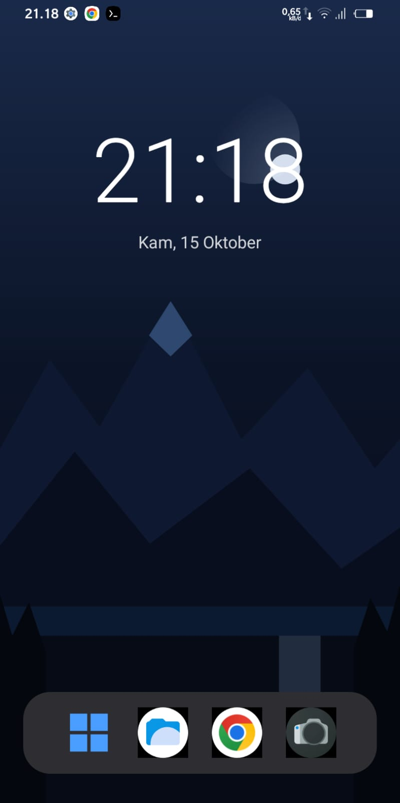
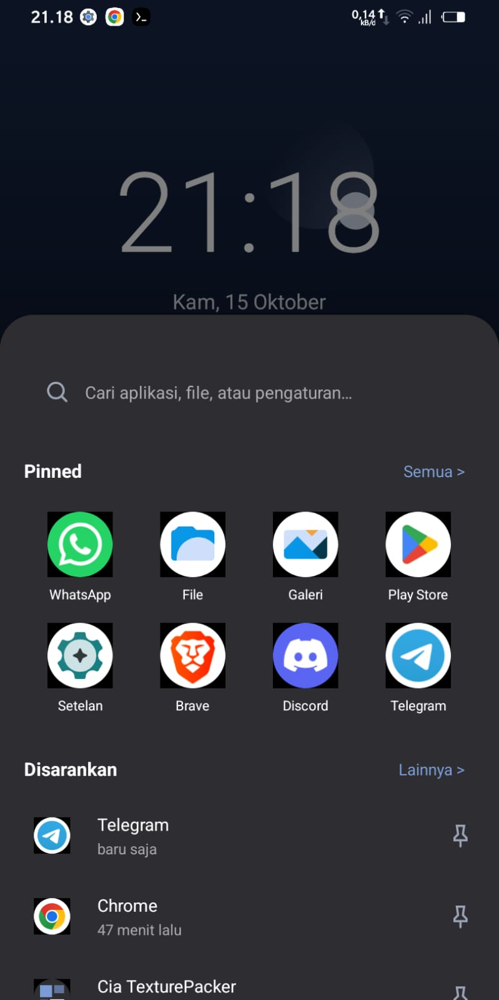
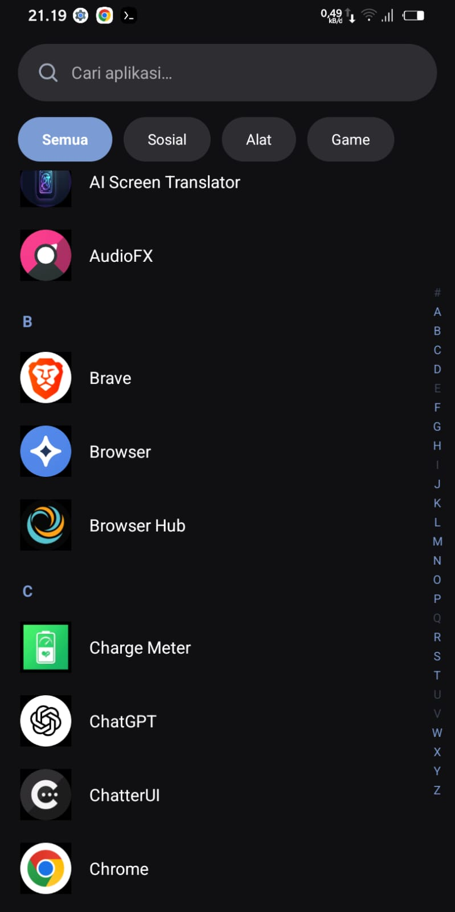

# Cia Launcher


Launcher Android custom ala Windows 11 versi gelap — jam besar, taskbar, menu Start, dan app drawer berkategori. Ringan dan responsif.

## Screenshots

| Home | Start Menu | App Drawer |
|:---:|:---:|:---:|
|  |  |  |

## Fitur

- **Layar utama** — jam besar (format Indonesia), tanggal, wallpaper custom, taskbar
- **Menu Start** (bottom sheet) — pencarian, aplikasi pinned, dan "Disarankan" (riwayat aplikasi yang dibuka)
- **App drawer** — tab kategori (Semua/Sosial/Alat/Game), pencarian live, indeks alfabet A–Z
- **Sembunyikan aplikasi** — long-press app di drawer untuk menyembunyikan dari UI
- **Hapus aplikasi** — long-press → hapus via PackageInstaller API bawaan launcher
- **Gesture** — swipe up di home → menu Start; swipe up lagi saat menu terbuka & mentok bawah → semua aplikasi; swipe kiri/kanan ganti kategori drawer
- **Taskbar custom** — slot aplikasi yang bisa diganti (tahan lama)
- **Wallpaper custom** — tahan lama di area kosong layar utama
- **Tema gelap** — abu gelap `#2E2E32` + aksen biru `#7B9BD4`
- **Optimasi** — snapshot PackageManager 60 detik, cache ikon (LruCache 32, RGB_565), kerja berat di background thread

## Download

APK terbaru tersedia di halaman [Releases](https://github.com/xhamzar/cia-launcher/releases). Setiap push tag `v*` otomatis membangun dan merilis APK baru via GitHub Actions.

## Build

**Kebutuhan:**
- Android Studio (terbaru) atau JDK 17 + Gradle 8.9
- Android SDK (compileSdk 35)

**Cara build:**
```bash
# Via Android Studio: buka project lalu Run > Run 'app'
# Via command line:
./gradlew :app:assembleDebug
```

APK hasil build: `app/build/outputs/apk/debug/app-debug.apk`

## Struktur Project

```
app/src/main/java/com/cia/launcher/
├── MainActivity.kt          # Layar utama: jam/tanggal, wallpaper, taskbar
├── StartMenuSheet.kt        # Menu Start (bottom sheet)
├── AppDrawerActivity.kt     # App drawer: kategori, pencarian, indeks A–Z
├── AppRepository.kt         # Akses PackageManager (snapshot + cache ikon)
├── DrawerAdapter.kt         # Adapter list drawer
├── PinnedAdapter.kt         # Adapter grid pinned
├── DrawerRootLayout.kt      # Layout custom penangkap gesture
├── AppPickerDialog.kt       # Dialog pilih aplikasi
├── HiddenAppsDialog.kt      # Dialog aplikasi tersembunyi
├── AppEntry.kt              # Model data aplikasi
├── PinnedPrefs.kt           # Simpan aplikasi pinned
├── RecentAppsPrefs.kt       # Riwayat aplikasi (untuk "Disarankan")
├── HiddenAppsPrefs.kt       # Daftar aplikasi tersembunyi
├── TaskbarPrefs.kt          # Slot taskbar custom
└── WallpaperPrefs.kt        # Wallpaper custom
```

## Lisensi

Project pribadi — all rights reserved.
